  
  
  
  

### 👋 About me

I'm a **Cloud Engineer in Germany** 🇩🇪. I build secure apps on **Azure and Kubernetes**, create **AI agents**, and teach **Python for free** to beginners.

- 🔭 **Now:** Software Engineer, Cloud Products at **baramundi software** (Augsburg)
- 🌿 **Side project:** founder of **The Growth Club**, a free community for code, languages and philosophy
- 💬 **Ask me about:** cloud architecture, AI agents, or getting started with Python
- 📫 **Reach me:** [LinkedIn](https://www.linkedin.com/in/vishal-s-694502112/)

## 🛠️ Tech I work with

   
   
  

  <b>Also:</b> AKS · KEDA · ArgoCD · Azure Functions · Event Hubs · Service Bus · IoT Hub · Azure AI Foundry · Semantic Kernel · MCP · RAG

## 🌿 The Growth Club

A free, 24/7 global community I founded for people who want to keep growing:
**programming** 💻, **English & German** 🌍 and **philosophy & debates** 🧠.

| | |
|---|---|
| 🐍 **Learn Python** | Free *Python Foundations* course on [YouTube](https://www.youtube.com/@TheGrowthClubOfficial), with code, exercises and quizzes in [python-foundations](https://github.com/VishalCodingNinja/python-foundations) |
| 🎙️ **Talk & learn** | 2,000+ members on [Discord](https://discord.com/servers/tgc-english-politics-philosophy-religion-24-7-vc-1386265102050787409): language practice, study rooms and weekly debates |
| 💼 **Follow** | [The Growth Club on LinkedIn](https://www.linkedin.com/company/thegrowthclubofficial) |

## 📌 Featured projects

| Project | What it is | Stack |
|---|---|---|
| [**python-foundations**](https://github.com/VishalCodingNinja/python-foundations) | Free beginner Python course: 30 demos, 7 exercises, quizzes and slides | Python |
| [**UniLingual**](https://github.com/VishalCodingNinja/UniLingual.Api) | One tool for all tongues | TypeScript |
| [**DebateLeadToSolution**](https://github.com/VishalCodingNinja/DebateLeadToSolution.UI) | Online portal to debate society's problems, built as micro UIs on 3 microservices ([API](https://github.com/VishalCodingNinja/DebateLeadToSolution.API)) | Angular · .NET |
| [**GangOfFour.DesignPatterns**](https://github.com/VishalCodingNinja/GangOfFour.DesignPatterns) | The classic Gang of Four design patterns in C# | C# |
| [**KeyVault.NetCore.POC**](https://github.com/VishalCodingNinja/KeyVault.NetCore.POC) | Reading secrets safely from Azure Key Vault in .NET | .NET · Azure |
| [**WebApiHMACAuthentication**](https://github.com/VishalCodingNinja/WebApiHMACAuthentication) | HMAC request signing for ASP.NET Web API | C# |

  <i>"Small daily improvements create extraordinary long-term results."</i>  
  

